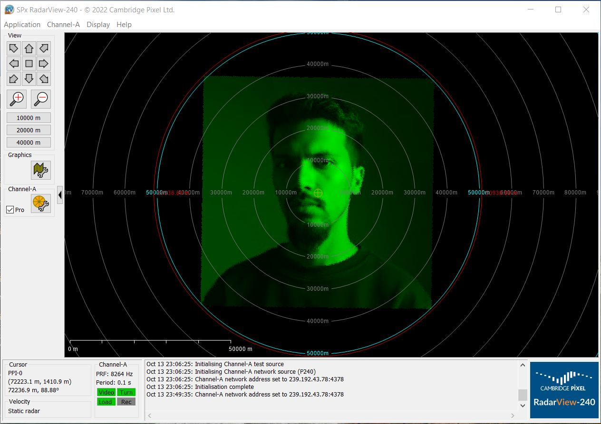

# ASTERIX Category 240

Sends ASTERIX Category 240 radar video, as defined in
[EUROCONTROL-SPEC-0149-240][spec] edition 1.3, over UDP. The library is written
against the POSIX socket, clock and sleep functions, so the same sources build
as a [Zephyr module][modules] and as a static library for Linux or any other
POSIX system.



A photograph streamed with `cat240-send` as one turn of radar video, shown on
the PPI of RadarView-240.

- `lib/asterix_cat240`: the library, enabled with `CONFIG_ASTERIX_CAT240`
- `include/asterix/cat240.h`: the public API
- `app`: a Zephyr sample that generates radials and sends them
- `host`: the CMake build for Linux, with the `cat240-send` tool
- `tests/lib`: the Twister test suites
- `doc`: Doxygen and Sphinx documentation
- `west.yml`: a manifest that pulls in Zephyr, so the repository can also be
  the manifest repository of its own west workspace

[spec]: https://www.eurocontrol.int/sites/default/files/content/documents/nm/asterix/20150513-asterix-cat240-v1.3.pdf
[modules]: https://docs.zephyrproject.org/latest/develop/modules.html

## Getting started

Set up a Zephyr development environment first, following the
[Zephyr Getting Started Guide](https://docs.zephyrproject.org/latest/develop/getting_started/index.html).

The repository is a west manifest repository and a Zephyr module. Either
create a workspace from it:

```shell
west init -m https://github.com/walidbadar/asterix-cat240 --mr main my-workspace
cd my-workspace && west update
```

or link it into an existing workspace, so that its manifest drives the
workspace's Zephyr checkout:

```shell
cd ~/zephyrproject
ln -s /path/to/asterix-cat240 asterix-cat240
west config manifest.path asterix-cat240
west update
```

Besides Zephyr, the manifest pulls in `cmsis_6` for the Cortex-M boards and
`picolibc`, which the native_sim builds use: the library goes through Zephyr's
POSIX layer, and that layer is only built with an embedded C library.

To use only the library from another project, add the repository to that
project's west manifest:

```yaml
    - name: asterix-cat240
      url: https://github.com/walidbadar/asterix-cat240
      revision: main
      path: modules/lib/asterix-cat240
```

or pass `-DZEPHYR_EXTRA_MODULES=/path/to/asterix-cat240` to the build.

### Building and running

```shell
cd asterix-cat240
west build -b $BOARD app
```

where `$BOARD` is a board with a network interface, for example `qemu_cortex_m3`
or `native_sim` with a TAP interface. A debug configuration is provided:

```shell
west build -b $BOARD app -- -DEXTRA_CONF_FILE=debug.conf
```

Run it with `west build -t run` on `qemu_cortex_m3`, which gets `192.0.2.1`
and sends to `192.0.2.2` on the QEMU network, or flash it with `west flash`.

### Running on native_sim

`native_sim` talks to the host through a TAP interface, `zeth`, created with
the `net-setup.sh` script of Zephyr's
[net-tools](https://github.com/zephyrproject-rtos/net-tools). The script gives
the host `192.0.2.2`, which is the sample's default destination, so the host
receives the stream:

```shell
# once per boot, from the net-tools checkout (tools/net-tools in a west workspace)
sudo ./net-setup.sh

cd asterix-cat240
west build -b native_sim/native/64 app
./build/zephyr/zephyr.exe
```

Watch the datagrams on the host with Wireshark on `zeth` (display filter
`asterix`) or with `nc -ul 8600 | xxd`. A 64 bit host without the 32 bit C
library needs `native_sim/native/64`; otherwise plain `native_sim` works too.

### Using the library

```c
#include <asterix/cat240.h>

static struct asterix_cat240 stream;
static uint8_t cells[256];

const struct asterix_cat240_config config = {
	.addr = "239.192.0.240",
	.port = 8600,
	.sac = 1,
	.sic = 1,
};
struct asterix_cat240_video video = {
	.start_az = azimuth,
	.end_az = azimuth + 1,
	.start_rg = 0,
	.cell_dur = 100,
	.resolution = ASTERIX_CAT240_RES_HIGH,
	.cells = cells,
	.len = sizeof(cells),
};

asterix_cat240_init(&stream, &config);
asterix_cat240_send_summary(&stream, "PSR raw video");
asterix_cat240_send_video(&stream, &video);
asterix_cat240_close(&stream);
```

A stream is bound to one destination, unicast or multicast, and one data
source identifier; an optional interface name in the configuration pins the
datagrams to that interface. Each radial goes out as one video message in one UDP
datagram; the library chooses the video block item, pads it, fills in the
counters, the sequence number and, with `CONFIG_ASTERIX_CAT240_TIME_OF_DAY`,
the time of day. The sample's destination is set with `CONFIG_APP_DEST_ADDR`
and `CONFIG_APP_DEST_PORT`.

### Sending a Cartesian image

`asterix_cat240_send_cartesian_video()` resamples an 8 bit raster into radials
around a chosen center pixel and sends them as one turn of video, so a viewer
such as RadarView-240 shows the image on its PPI. The sample sends a test
pattern with range rings, a crosshair and a sector between 30 and 60 degrees
when built with the `cartesian.conf` fragment:

```shell
west build -b $BOARD app -- -DEXTRA_CONF_FILE=cartesian.conf
```

### Building for Linux

```shell
cmake -S host -B build-host
cmake --build build-host
ctest --test-dir build-host
```

This produces `libasterix_cat240.a`, runs the same test suites as on Zephyr
against the loopback interface, and builds `cat240-send`, which streams a raw
8 bit image or a built-in test pattern to a viewer such as RadarView-240:

```shell
./build-host/cat240-send -p 8600 192.168.1.20              # test pattern
./build-host/cat240-send -i eth0 192.168.1.20              # out of a given interface
./build-host/cat240-send 192.168.1.20 image.raw 512 512    # raw 8 bit image
```

Your own program includes `asterix/cat240.h` and links the library. The
settings `ASTERIX_CAT240_TX_BUF_SIZE`, `ASTERIX_CAT240_MCAST_TTL` and
`ASTERIX_CAT240_TIME_OF_DAY` can be defined on the compiler command line; on
Zephyr they follow the Kconfig options.

### Testing on Zephyr

```shell
west twister -T tests --integration
```

The output lands in `doc/_build_doxygen` and `doc/_build_sphinx`.

## License

GPL-3.0-only, see [LICENSE](LICENSE). Every source file carries an SPDX
license identifier.
